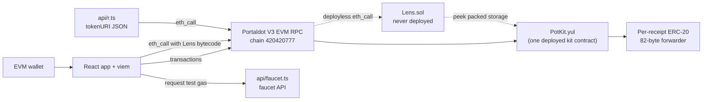
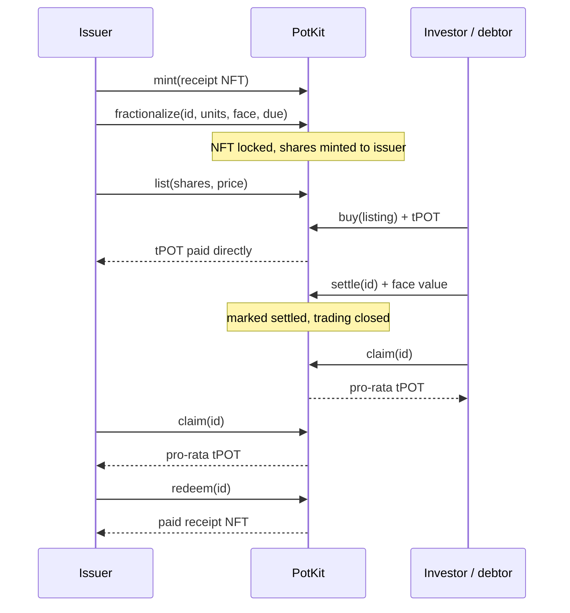

# PotKit - tokenised receipts on Portaldot V3

**Links:** [Live app](https://app.potkit.pro) · [Website](https://potkit.pro) · [Demo video](https://youtu.be/Cr7XRDwAU6g) · [X](https://x.com/potkitpro) · [Judge link](https://app.potkit.pro/?kit=0x3c26351ad8b9dc7bb4f837c5b921879c35e20fb7)

**Track:** Ecosystem DApps (RWA tokenisation) · Portaldot Hacker House 2026

PotKit turns a real-world receipt (an invoice, a content right, a piece of equipment) into an
**ERC-721**, locks it, and issues a fixed supply of **ERC-20 shares** against it.
The NFT is held by the contract while shares are outstanding. Shares provide a claim on a pro-rata payout **only if the receipt is settled in native tPOT**; an NFT alone does not verify an off-chain invoice. A public board reads contract state without a wallet.

The deployed version uses **one contract, `PotKit`** (hand-written Yul): receipt NFT, vault, settlement pool and share market. Each share token is an 82-byte forwarder whose ERC-20 balances live in PotKit.

## Judge quick start
Steps 1–3 need no wallet and no test tokens.
1. **Watch the demo video:** https://youtu.be/Cr7XRDwAU6g
2. **Open the live app on the deployed contract:** [app.potkit.pro/?kit=0x3c26351ad8b9dc7bb4f837c5b921879c35e20fb7](https://app.potkit.pro/?kit=0x3c26351ad8b9dc7bb4f837c5b921879c35e20fb7). Dashboard, Explore and Verify read straight from Portaldot V3; connect a wallet only if you want to transact.
3. **Check the on-chain evidence:** [Testnet evidence](#testnet-evidence) lists the whole lifecycle (deploy → mint → lock → list → buy → settle → claim → redeem) with UTC times and a block link per transaction. Any hash can be checked with `eth_getTransactionReceipt`.
4. **Run it yourself with no tokens** (local chain with sample data):
   ```bash
   npm install
   npx ganache --chain.chainId 420420777 --wallet.deterministic    # terminal 1: local chain, in memory
   node scripts/seed-local.mjs                                     # terminal 2: prints {"kit":"0x…","alice":"0x…","bob":"0x…"}
   VITE_RPC_URL=http://localhost:8545 npm run dev                  # terminal 3: open the URL Vite prints, then /app?kit=<kit from step 2>
   ```
   Explore, Verify and the Dashboard work without a wallet. To transact, add the network manually in MetaMask (RPC `http://localhost:8545`, chain ID `420420777`) and import a Ganache deterministic account: account 0 (`alice`) is the issuer and can mint; the other accounts can buy, settle and claim. Restarting Ganache resets the chain.
5. **Mint on the shared testnet kit:** minting is limited to the issuer and approved minters (any other wallet gets `not minter`); holding, trading, settling and claiming are open to everyone. Send your 0x address to the team on Discord; the issuer decides whether to approve it, with `node scripts/set-minter.mjs 0xYourWallet --send` (issuer key only; without `--send` it is a read-only dry run). How the issuer does this: [step 6](#6-approve-a-tester-as-minter-issuer-only). The PotKit faucet is closed: test tokens are handed out by the Portaldot team to hackathon participants.

## How it works
1. **Mint:** The deployer (issuer) or an issuer-approved minter creates an ERC-721 receipt with a type and note. No invoice document or debtor signature is checked by the contract.
2. **Lock:** The NFT owner calls `fractionalize(id, units, faceValue, dueDate)`. PotKit holds the NFT, fixes the terms for this lock cycle, and issues all fixed-supply shares to the depositor. The due date is optional.
3. **Trade:** Holders can transfer shares or escrow them in fixed-price tPOT listings; buyers pay the seller directly when purchasing. A listing can be cancelled by its seller to return unsold shares.
4. **Settle:** Anyone can pay at least the face value in native tPOT once. That amount enters the payout pool, and further listings and buys are blocked. No one is compelled to make this payment.
5. **Claim:** Each wallet holding shares calls `claim` to burn its entire balance and receive its pro-rata tPOT. Sellers must cancel any remaining listings to recover escrowed shares before they can claim those shares. After all claims, the depositor may redeem the paid NFT. Before settlement, a holder of *all* outstanding shares may instead redeem the NFT, burning those shares.

## Architecture


The React app uses viem for wallet writes and read-only RPC calls. PotKit.yul is the deployed contract containing the ERC-721 receipt, vault, native-tPOT settlement pool, and fixed-price market. Lens.sol is not deployed: its bytecode runs inside `eth_call` and reads PotKit's packed storage through `peek`.

**Lifecycle**


## Why it is more than a demo
| Concern | How PotKit handles it |
|---|---|
| Are shares really backed? | `PotKit` holds the NFT while shares exist; shares can only be burned by `PotKit` (redeem / claim) |
| Standards | ERC-721 + ERC-165 + metadata (`tokenURI` → `/api/r?id=N`, JSON built by `Lens` from on-chain data); shares are ERC-20 (transfer, approve, allowance, transferFrom, events) |
| Who can attest receipts? | Issuer + issuer-approved minters; anyone can hold, trade and fractionalize what they own |
| Can supply be inflated? | No. Supply is fixed at lock time; no mint function exists for shares |
| Nonexistent ids | `ownerOf` / `tokenURI` revert |
| Do shares have real value? | `settle` takes native tPOT ≥ face value into the pool; `claim` pays `amount × shares / supply` (cumulative rounding, the pool empties exactly) |
| Settlement griefing | Terms are fixed in the same transaction as the lock; anyone may pay, but only ≥ face value, and only once |
| Exits after pay | Settling twice reverts; redeem is blocked until every share is claimed, then only the depositor can take the paid receipt back |
| Reentrancy | Checks-effects-interactions everywhere: state is written before any tPOT is sent, and the payment is the last call |
| Spoofed tokens/events | Only `PotKit`-created share tokens are accepted (`token → receipt` mapping); share events are emitted by the token address itself |
| Secondary market | Escrowed fixed-price listings, partial buys, cost rounds up, exact `msg.value`, seller paid directly, closed after settlement |
| Invoice status | Pending / Due soon (≤ 3 days) / Overdue / Settled, derived by `Lens` from on-chain due date + settlement |
| Frontend state | Everything comes from the chain (`Lens` run inside `eth_call`): shareable "judge link", no database |
| Reproducible builds | `scripts/compile.mjs` with pinned `solc@0.8.28` (Yul + Solidity), optimizer runs = 1, EVM `paris` (no PUSH0), no metadata |

## Share ownership & repayment
A share is a fixed-fraction claim on the **native tPOT settlement pool for this locked receipt**. It is not legal ownership of the underlying invoice, a debtor signature, or a guaranteed investment return. At lock time, `units × 10¹⁸` ERC-20 share units are issued to the depositor; the supply cannot be increased for that lock cycle. Shares can be transferred or traded before settlement. The NFT remains in PotKit while shares are outstanding, so a holder of every outstanding share can redeem before settlement.

Anyone can call `settle(id)` with at least the face value. The entire payment, including any overpayment, becomes the pool. Settlement closes listing and buying. Each holder claims once; `claim` burns all shares held by that caller and pays the pro-rata amount using cumulative rounding. A seller must cancel an open listing first so its escrowed shares return to a wallet. After every share is claimed, only the original depositor can redeem the paid receipt NFT.

## Default / overdue handling
The optional due date is used only by `Lens.statuses`: an unpaid locked receipt becomes **Overdue** after that timestamp. This is a read-only status derived from the current block time; no keeper or contract transition runs at the due date. There is currently no default procedure, penalty, collateral liquidation, forced repayment, recovery waterfall, or automatic investor compensation. A late `settle` is still accepted at any time, and holders cannot claim until settlement. Default handling is a roadmap item rather than a shipped feature.

## Assumptions & limitations
- Invoice notes and terms are issuer/depositor self-reported. The contract does not verify the invoice, delivery, debtor identity, debtor consent, or legal enforceability.
- There is no oracle, KYC, debtor attestation, credit underwriting, stablecoin, or mainnet deployment. All payments here use testnet native tPOT.
- The app simulates the roles of issuer, seller, buyer/investor, and debtor with wallets; the contract does not know which wallet is the real debtor.
- Minting is permissioned: only the issuer and approved minters can mint (`not minter` otherwise). Holding, trading, settling and claiming are open to everyone. The issuer approves a minter with `setMinter` (see `scripts/set-minter.mjs`).
- The contract does not look at the due date when someone buys, so it still accepts a purchase on an overdue, unpaid invoice. The app hides the Buy button for overdue listings as a product rule.
- The RPC can discard old block state/log ranges. The app estimates event timestamps from the latest block at roughly six seconds per block and labels those times approximate; block numbers and transaction hashes remain the evidence.
- Open listings are not automatically cancelled at settlement. Sellers must cancel them before claiming, and the depositor cannot redeem until all shares have been claimed.

## Portaldot integration
PotKit is deployed to Portaldot V3 EVM testnet, chain ID **420420777**, using the public RPC `https://test-evm-rpc-v3.portaldot.dev`. The deployed kit address is `0x3c26351ad8b9dc7bb4f837c5b921879c35e20fb7`. The app reads the kit and the never-deployed Lens through `eth_call`; writes use the wallet on the same network. Portaldot's EVM address maps to a Substrate gas account: use the [node console](https://node-console.portaldot.dev/) → Developer → Runtime calls → `reviveApi` → `accountId` to find it, then fund that mapped account with **tPOTv3**. Transaction proof links use the [Portaldot node console explorer](https://node-console.portaldot.dev/?rpc=wss%3A%2F%2Ftest-node-v3.portaldot.dev#/explorer).

## Testnet evidence
The recorded end-to-end testnet run for kit `0x3c26351ad8b9dc7bb4f837c5b921879c35e20fb7` on chain 420420777. Every hash below was re-checked against the public RPC with `eth_getTransactionReceipt` (status `0x1`, sent to the kit; the deploy receipt returns it as `contractAddress`); times are the block timestamps in UTC. The deployed code is 3,910 bytes.

| Step | Block | Time (UTC) | Transaction hash |
|---|---:|---|---|
| Deploy kit | [97421](https://node-console.portaldot.dev/?rpc=wss%3A%2F%2Ftest-node-v3.portaldot.dev#/explorer/query/97421) | 2026-10-19 03:15:12 | [`0x5ce8a4a4661025a4cac0fe059dd3f10b111a05890c4530abb5d6490c9bf41614`](https://pindex.onrender.com/app/?q=0x5ce8a4a4661025a4cac0fe059dd3f10b111a05890c4530abb5d6490c9bf41614) |
| Mint receipt #1 | [97600](https://node-console.portaldot.dev/?rpc=wss%3A%2F%2Ftest-node-v3.portaldot.dev#/explorer/query/97600) | 2026-10-19 03:33:06 | [`0x734848b6b369f4b54fd204f0fe96253bab46bb6cd73ff495f5f36bba2bcd7bee`](https://pindex.onrender.com/app/?q=0x734848b6b369f4b54fd204f0fe96253bab46bb6cd73ff495f5f36bba2bcd7bee) |
| Lock + terms + issue 100 shares | [97632](https://node-console.portaldot.dev/?rpc=wss%3A%2F%2Ftest-node-v3.portaldot.dev#/explorer/query/97632) | 2026-10-19 03:36:18 | [`0x6b36874b7e82cb29098017292314243aea17accc1825169b6ea81223637a846d`](https://pindex.onrender.com/app/?q=0x6b36874b7e82cb29098017292314243aea17accc1825169b6ea81223637a846d) |
| List 90 shares @ 0.009 tPOT | [97654](https://node-console.portaldot.dev/?rpc=wss%3A%2F%2Ftest-node-v3.portaldot.dev#/explorer/query/97654) | 2026-10-19 03:38:30 | [`0x36d70079020ad47a3b7350794c706bc68a87980cac1e08789a0516f4cc7ede4d`](https://pindex.onrender.com/app/?q=0x36d70079020ad47a3b7350794c706bc68a87980cac1e08789a0516f4cc7ede4d) |
| Buy 90 shares (0.81 tPOT) | [97684](https://node-console.portaldot.dev/?rpc=wss%3A%2F%2Ftest-node-v3.portaldot.dev#/explorer/query/97684) | 2026-10-19 03:41:30 | [`0xd9adf39c377817b8761e9e48814ba18c605dd464e9e3fd7515b9fbab8b930cb5`](https://pindex.onrender.com/app/?q=0xd9adf39c377817b8761e9e48814ba18c605dd464e9e3fd7515b9fbab8b930cb5) |
| Settle (debtor pays 1 tPOT) | [97706](https://node-console.portaldot.dev/?rpc=wss%3A%2F%2Ftest-node-v3.portaldot.dev#/explorer/query/97706) | 2026-10-19 03:43:42 | [`0xa3c4e3920fc77a62d5c6c9902994285ff22345f92feb69e824d6583db81df25c`](https://pindex.onrender.com/app/?q=0xa3c4e3920fc77a62d5c6c9902994285ff22345f92feb69e824d6583db81df25c) |
| Claim (investor, 0.9 tPOT) | [97713](https://node-console.portaldot.dev/?rpc=wss%3A%2F%2Ftest-node-v3.portaldot.dev#/explorer/query/97713) | 2026-10-19 03:44:24 | [`0x41e96b79547671cf597ee0c3f7b27635fbfaf82c55b8b1231cecf47b640dd557`](https://pindex.onrender.com/app/?q=0x41e96b79547671cf597ee0c3f7b27635fbfaf82c55b8b1231cecf47b640dd557) |
| Claim (issuer, 0.1 tPOT) | [97719](https://node-console.portaldot.dev/?rpc=wss%3A%2F%2Ftest-node-v3.portaldot.dev#/explorer/query/97719) | 2026-10-19 03:45:00 | [`0x83cc9d7f3606d28e9cdd4c9dcd58525731987b79ffdf404a1952dd2bcf420e66`](https://pindex.onrender.com/app/?q=0x83cc9d7f3606d28e9cdd4c9dcd58525731987b79ffdf404a1952dd2bcf420e66) |
| Redeem paid receipt NFT | [97722](https://node-console.portaldot.dev/?rpc=wss%3A%2F%2Ftest-node-v3.portaldot.dev#/explorer/query/97722) | 2026-10-19 03:45:18 | [`0x8e4f7704cce8d0224116c855f5789a5ef18260714a9520eddb00ed4e0cdf1b89`](https://pindex.onrender.com/app/?q=0x8e4f7704cce8d0224116c855f5789a5ef18260714a9520eddb00ed4e0cdf1b89) |

The node console explorer is Substrate-based: it opens **block numbers** but cannot resolve an EVM transaction hash, so each block above links to its console page. Each hash links to the community explorer [Pindex](https://pindex.onrender.com), which resolves EVM transaction hashes on the V3 testnet (checked for all nine on 2026-10-30: status, block and the kit as recipient); the hashes are also verified through the RPC. At first Pindex lacked part of this contract's history; after its author backfilled it, all 28 post-deploy transactions resolved (checked 2026-10-31). Its index trails the chain tip (about 1,300 blocks when checked), so very recent transactions can be missing for a while: the RPC stays the reference, and the app keeps linking block pages. The contract was deployed once (block 97421); the web frontend is a separate Vercel deployment that is rebuilt as the UI changes, so its deploy dates are not the contract's.

## Roadmap
- Add debtor attestation/signatures, issuer reputation, and invoice-document verification without pretending that on-chain metadata is proof.
- Define an explicit default/recovery policy, including partial payments and any permitted restructuring or buyout flow.
- Add an indexer and explorer links when Portaldot V3 history is reliably available; preserve approximate-time labels when it is not.
- Explore optional stablecoin settlement, KYC/compliance integrations, and deeper secondary-market mechanisms for a production deployment.

## Landing page
`/` is the marketing landing: a dark violet hero with an animated receipt → shares → settlement illustration, an evidence strip of checkable facts, a scroll-driven lifecycle walkthrough, product tabs, a proof section built from this repository (contract excerpts, test names), a resource list and a receipt-number verification form. Every mock-up is labelled illustrative, and the page states that issuer-provided information is not verified and that payment is not guaranteed. Motion respects `prefers-reduced-motion`.

The dApp lives at **`/app`**: a left sidebar on desktop with a wallet status block (connected, wrong network or not connected, address, network and balance), and a top row with a bottom tab bar on phones. Every on-chain write shows a step panel: approve in the wallet, sent (with the hash), confirmed or failed. A switch in the top bar turns on an optional light theme, remembered in the browser; dark is the default. Judge links can pass the kit address (`?kit=0x…`). Landing styles are in `src/landing-pk.css`; the app's styles are in `src/styles/`, with the final layers in `night*.css` (`night-light.css` holds the light theme).

## Hosting on Vercel
`vercel.json` rewrites every path except `/api/*` to `index.html`, so `/app` works on refresh (static assets are served first).
Redeploy: `vercel --prod` from the project folder (keep the `.vercel/` folder that links it to the existing project, or run `vercel link` and pick `potkit`).

**Receipt metadata:** `tokenURI(id)` returns `https://potkit.pro/api/r?id=N`. `api/r.ts` (which also adds an `image`) answers it by running `Lens.tokenJson` in an
`eth_call` against the contract in `VITE_KIT` (override with `&kit=0x…`; RPC from `VITE_RPC_URL`). Set `VITE_KIT` on Vercel so the endpoint knows the deployment.

**Optional `app.` subdomain:** if the hostname starts with `app.`, the dApp renders at `/` and "Back to site" points to the bare domain.
1. Vercel → Project *potkit* → Settings → Domains → Add `app.yourdomain.com` (and `yourdomain.com` for the landing).
2. Add the DNS record Vercel shows (CNAME `app` → `cname.vercel-dns.com`).
3. Both domains use the same deployment; no code change needed. (`*.vercel.app` names can't take an `app.` prefix — use a custom domain.)

## Local UI testing with sample data
`VITE_RPC_URL` overrides the RPC (default: public Portaldot V3 testnet). For a filled-in UI without testnet gas:
```bash
npx ganache --chain.chainId 420420777 --wallet.deterministic   # terminal 1
npm run compile && node scripts/seed-local.mjs        # deploys PotKit + sample receipts/listings/settlement, prints the address
VITE_RPC_URL=http://localhost:8545 npm run dev        # open /app?kit=0x… (import a ganache key into MetaMask)
```

## Run guide (step by step)

### 1. Local dev
Requires Node.js 20+.
```bash
npm install
npm test        # compiles the contracts, then runs the whole suite in test/ (PotKit on local Ganache, faucet, network switch, transaction errors, settle and trade input checks, receipt history, dashboard figures, the `set-minter` script)
npm run dev     # open the URL Vite prints (http://localhost:8080 by default)
npm run build   # type-check + production build into dist/
```

### 2. Add Portaldot V3 Testnet to MetaMask
MetaMask → network selector → **Add network → Add a network manually**:

| Field | Value |
|---|---|
| Network name | Portaldot V3 Testnet |
| RPC URL | `https://test-evm-rpc-v3.portaldot.dev` |
| Chain ID | `420420777` |
| Currency symbol | `tPOTv3` (14 decimals) |

(Or just press **Switch to Portaldot V3** in the app — it adds the network for you.)

### 3. Map your account and fund gas
Portaldot gas is paid by the **mapped** Substrate account, not the 0x address directly.
1. Open the [node console](https://node-console.portaldot.dev/) → Developer → Runtime calls → `reviveApi` → `accountId`, enter your 0x address to get the mapped account.
2. Fund that mapped account with tPOTv3 (ask the Portaldot team on Discord, as the PotKit faucet is closed; see the [testnet guide](https://github.com/ItsCogumellum/portaldot-v3-testnet-guide)).
3. A second wallet for the "buyer / debtor" role needs ~6 tPOT (buy + 1 tPOT face value + ~3.9 tPOT settle deposit + gas): send it from wallet A (a plain transfer to its 0x address credits its mapped account).

### 4. Deploy from the UI (one transaction, ≈327 tPOT)
1. **Issue → Deploy** (one transaction). You are now the receipt issuer. There is no token or market to deploy: payments are native tPOT.
2. **Copy judge link** — the URL carries the address (`/app?kit=0x…`). To bake it into a hosted build, put it in `.env`
   (`VITE_KIT`, plus `VITE_FROM_BLOCK` = deploy block, see `.env.example`) and rebuild. The old names `VITE_RECEIPT` / `VITE_VAULT` / `VITE_MARKET`
   are still read and may all point to the same address; `VITE_USD` is unused.
   Vite bakes these at build time — on Vercel set them as Environment Variables and redeploy after each change.
   When the baked `.env` deployment changes, browsers automatically drop their old saved addresses; **Profile → Reset saved deployment** does it manually.

### 5. Demo script (≈3 min, ≈47 tPOT of deposits)
1. Mint *"Invoice 042 — content delivery"* (kind Invoice).
2. **Lock, set terms & issue shares**: 100 shares, face value 1 tPOT, due date in ~2 days → badge **Due soon** (a past due date shows **Overdue**). One transaction.
3. **Trade → List** 90 shares at 0.009 tPOT (the freelancer sells at a 10% discount for cash now). No approval step.
4. Send ~6 tPOT to wallet B. Switch to wallet B and buy 90 shares (0.81 tPOT goes straight to the seller).
5. Wallet B (as debtor) → **Explore → Pay** on the receipt: 1 tPOT → badge **Settled**, trading closes.
6. Each holder opens **Portfolio** and presses **Claim**: B gets 0.9 tPOT (profit 0.09), A gets 0.1 tPOT.
7. Wallet A: **Portfolio → Redeem** takes the paid receipt NFT back (refunds the lock's storage deposit). Show **Explore** / **Verify**.

### 6. Approve a tester as minter (issuer only)
Only the issuer wallet (`0xd1AffC3b88E23bCBfF209b36267744f8e2035BFB`, read from `issuer()`) can call `setMinter`; nobody else can, and a minter cannot approve other wallets (`not issuer`). An approved minter can `mint` receipts (kind 0–2, note 1–140 bytes) to any address and nothing else extra: it cannot touch other people's receipts or funds. Revoking stops future mints only; receipts already minted stay where they are. A wallet that only buys or invests needs no approval.

| | |
|---|---|
| Network | Portaldot V3 Testnet, chain ID `420420777`, RPC `https://test-evm-rpc-v3.portaldot.dev` |
| Contract | `0x3c26351ad8b9dc7bb4f837c5b921879c35e20fb7` |
| Cost to the issuer | about 3.92 tPOT to approve a new minter (a new storage slot; simulated with `eth_estimateGas`). Revoking costs very little gas and should refund that deposit when the slot is cleared (not yet checked on-chain). |
| Cost to the tester | the tester pays for minting: about 11.7 tPOT for a 30-character note, up to about 27.3 tPOT for 140 characters, and about 35.4 tPOT more to lock and set terms (table below). The faucet is closed, so send the tester tPOT first. |

1. **Dry run** (reads the chain only; no key, nothing is sent): `node scripts/set-minter.mjs 0xTesterWallet`. Check that `issuer` is your wallet, `minter now: false` and `wanted: true`, and read the `estimate` line (expected cost and the issuer's balance).
2. **Enter the issuer key for this terminal session only** (never in a file, never pasted into chat). PowerShell, which does not keep the input in the history:
   ```powershell
   $s = Read-Host "Issuer key" -AsSecureString
   $env:ISSUER_PRIVATE_KEY = [Runtime.InteropServices.Marshal]::PtrToStringAuto([Runtime.InteropServices.Marshal]::SecureStringToBSTR($s))
   ```
   bash: `read -rs ISSUER_PRIVATE_KEY; export ISSUER_PRIVATE_KEY`
3. **Approve:** `node scripts/set-minter.mjs 0xTesterWallet --send`. The script refuses if the key is not the issuer's or the balance is too low, then prints the transaction hash, the block (with a link) and `minter now true`. Then clear the key: `Remove-Item Env:ISSUER_PRIVATE_KEY` (bash: `unset ISSUER_PRIVATE_KEY`).
4. **Check at any time:** run step 1 again; it prints `minter now: true`.
5. **Revoke after the test:** enter the key again, run `node scripts/set-minter.mjs 0xTesterWallet --off --send`, clear the key, and run the dry run to see `false`.

Notes: the `--send` path is covered by `test/setminter.test.mjs` on a local Ganache chain only, and the dry run was run on Portaldot (read-only); no Portaldot transaction has been sent with this script yet, so try it first with a second wallet you control. The RPC gateway sometimes returns a transient HTML error; run the command again. Receipts a tester mints on the shared kit are public (Explore) and add to the kit's transaction count, so start the note with `TEST`.

### Invoice status (`Lens.statuses()`)
`None` (not locked) · `Pending` · `Due soon` (≤ 3 days to due date) · `Overdue` (past due, unpaid) · `Settled`.
The due date is optional (0 = none). Late payment is still accepted.

### Market (inside `PotKit`)
Fixed-price listings priced in tPOT. Shares are **escrowed** in the contract on `list`, so a listing can never point at shares the
seller has moved; `buy(listing, amount)` takes partial or full amounts, cost rounds **up** in the seller's favour and must be sent
exactly as `msg.value` (that also replaces a slippage cap: the price can't change under you); payment goes to the seller directly;
`cancel` returns the rest. Listing needs a locked, unsettled receipt; buying/listing is blocked once the invoice is settled (cancel, then claim). The contract does not check the due date on a purchase; the app hides Buy on overdue listings as a product rule.

### Profile, Dashboard and the pay page
- **Profile** (wallet menu → Profile, or `?tab=profile`): wallet identity and roles, an on-time payment record computed from scanned events, receipts issued and shares bought, achievements, and the **mapped gas account** (with Copy). Name, bio and avatar are stored in the browser only. A stale saved deployment is dropped automatically when the baked `VITE_KIT` changes, and a `?kit=` link always wins.
- **Dashboard**: market figures read from the chain (outstanding face value with a maturity line placing open receipts by due date, open listings, traded and settled tPOT, upcoming payments, settlement record, latest receipt, recent activity) and an 8-step *Your progress* tracker computed from the wallet's own on-chain activity. The *Cash-now planner* estimates what selling part of a receipt could raise; it sends nothing.
- **Pay page** (`?tab=pay&id=N`): a debtor-facing page for one receipt. The debtor may sign an optional acknowledgement (EIP-712, off-chain, no gas). It only shows which wallet signed; the contract does not use it.

Deployed kit and recorded transaction hashes are collected under [Testnet evidence](#testnet-evidence). Judge link: https://app.potkit.pro/?kit=0x3c26351ad8b9dc7bb4f837c5b921879c35e20fb7

## On-chain cost (Portaldot storage deposit)
Portaldot V3 (pallet-revive) charges a **storage deposit**: about 0.079 tPOT for each byte of deployed code, ~13.3 tPOT per contract,
and about 3.9 tPOT for each new storage slot (refunded when the slot is cleared). Normal gas is tiny next to that.
Figures from `eth_estimateGas` on the V3 testnet (gas price ≈ 39,300 wei), measured with `node scripts/measure.mjs`:

| | v30 | v31 |
|---|---:|---:|
| Deploy (Receipt + Vault + TestUSD + Market → one PotKit) | 1,386 tPOT | **327 tPOT** |
| Mint receipt (30-char note / 140-char note) | 11.7 / 27.3 | 11.7 / ~27.3 |
| Lock + set terms (first lock) | 32.5 + 3.9 | **35.4** (one tx) |
| List shares | 19.5 | 11.7 |
| Buy (incl. faucet + approve in v30) | ~19.5 | 0 |
| Settle | 7.8 | 3.9 |
| Claim (each) | −3.9 | −3.9 (refund) |
| Redeem after full claim | — | −7.8 (refund) |
| **Full demo flow** (mint → lock+terms → list → buy → settle → 2 claims → redeem) | ~87 | **~47** |
| **Deploy + full demo** | ~1,473 | **~375** (+ ~1–2 tPOT gas) |

How: (1) **One contract** written in Yul instead of four Solidity contracts — code deposit is paid once. (2) **Native tPOT** for settlement
and trading: no TestUSD, no approvals, no faucet transaction. (3) Share tokens are **82-byte forwarders** (one code hash): every ERC-20 call is
forwarded to `PotKit`, which keeps balances and emits the events through the token. (4) **Everything read-only lives in `Lens.sol`**, which is
never deployed: viem runs its bytecode inside `eth_call` and it reads raw storage via `PotKit.peek(slots)`. (5) Packed storage, one generic
`Activity` event, one-letter revert codes (mapped back to readable messages in the UI via `REASON_CODES`), optimizer runs = 1, no metadata.
**Wallet fee display.** On Portaldot the gas estimate includes the storage deposit, so the gas *limit* is worth real money. For every write the
dApp sets the gas limit to the estimate + 20% and passes the chain's gas price as `maxFeePerGas` with a zero tip (otherwise a wallet adds its
default tip / base-fee multiplier and shows an absurd maximum). If estimate + 20% would exceed your balance, the buffer shrinks so the
maximum stays 1 tPOT under the balance (never below the raw estimate). For the deploy the wallet shows a maximum of ≈393 tPOT; ≈327 tPOT is actually charged.
Limits from packing: face value and listing price ≤ 2^96−1 wei, share units ≤ 2^40−1, due date ≤ 2^40−1 s.

## Layout
```
contracts/   PotKit.yul (deployed kit), IPotKit.sol (ABI), Lens.sol (eth_call only), test/, v30/ (reference)
scripts/     compile.mjs, yulprep.mjs, seed-local.mjs, set-minter.mjs (issuer admin), measure.mjs and measure/ (cost measurement)
api/         faucet.ts, r.ts (tokenURI JSON)
test/        potkit, faucet, netswitch, txerrors, settlecheck, receipt-history, insights, params, setminter (*.test.mjs)
src/         main.tsx, App.tsx, Landing.tsx, lib/chain.ts (viem), tabs/ (app views), docs/ (guides)
             theme-tokens.css, landing-pk.css (landing), docs/docs-pk.css (doc pages)
             styles/ (dApp styles; the night*.css files are the final layers)
```
Contract builds generate `src/generated/`; no contract changes are part of this README update.

## Third-party software and assets
No third-party Solidity/Yul code is used in the contracts (`PotKit.yul`, `Lens.sol` are original). The web app and tooling use:

| Package | Version | License | Use |
|---|---|---|---|
| react, react-dom | 19.x | MIT | UI |
| viem | 2.57 | MIT | RPC, ABI encoding, wallet calls |
| @noble/hashes | 1.8 | MIT | blake2b for the mapped `5…` account |
| lenis | 1.3 | MIT | smooth scrolling on the docs pages |
| vite, @vitejs/plugin-react | 7.x / 5.x | MIT | build tooling |
| typescript | 5.9 | Apache-2.0 | type checking |
| solc (solc-js) | 0.8.28 | MIT | compiling Yul / Solidity |
| ganache | 7.9 | MIT | local test chain |

Assets: wallet logos are bundled locally (see `src/assets/wallets/SOURCES.md`: web3icons MIT, simple-icons CC0; trademarks belong to their owners). Fonts Hanken Grotesk, Newsreader and IBM Plex Mono are loaded from Google Fonts (SIL Open Font License). Landing and dApp visuals were created for this project; layout ideas came from public design references, and no code, images, logos or text were copied.

## Known limitations
See [Assumptions & limitations](#assumptions--limitations) and [Default / overdue handling](#default--overdue-handling). The contract is immutable and its `tokenURI` points at `https://potkit.pro/api/r`; the JSON is built off-chain from chain state.

## Gas faucet

> **Status:** the production faucet is closed. During the hackathon, test tokens are handed out by the Portaldot team to participants (Portaldot Discord). The code below is kept for self-hosting; without `FAUCET_PRIVATE_KEY` the app shows the mapped account for manual funding and says where tokens come from.

New users can't send a transaction without tPOTv3, so PotKit ships a small **"Request test gas"** faucet:
a Vercel Function at `api/faucet.ts` (Node runtime, viem) plus a button in the gas tip, the Profile page
and the "not enough gas" banner that appears when a write fails for insufficient funds.

- `GET /api/faucet?address=0x…` → `{ enabled, address, balance, amount, recipient: { balance, eligible } }`
- `POST /api/faucet` `{ "address": "0x…", "chainId": 420420777 }` → `{ ok, hash }` or `{ ok:false, error, message }`
  with `error` ∈ `bad_address`, `wrong_chain`, `already_funded`, `rate_limited`, `faucet_empty`, `faucet_disabled`, `rpc_unavailable`, `send_failed`.

Amounts are in the **18-decimal EVM view** (the Ethereum RPC scales Portaldot's 14-decimal native unit to 18;
the same as wallets). A native transfer to a 0x address credits that address's mapped `5…` gas account.

### Setup (Vercel)
1. Create a **new, dedicated** EVM wallet just for the faucet (never your main or deployer wallet).
2. Find its mapped gas account (connect it in PotKit → Profile, or the node console) and fund that `5…` account with a **small** amount of tPOTv3.
3. Vercel → Project → Settings → Environment Variables (**Production**): set `FAUCET_PRIVATE_KEY` (and optionally `FAUCET_AMOUNT`, default `0.5`; `FAUCET_THRESHOLD`; `FAUCET_MAX_PER_HOUR`, default `30`; `FAUCET_RPC_URL`). **Do not** prefix them with `VITE_` — that would ship the key to every browser.
4. Optional but recommended: add Vercel KV / Upstash Redis (Marketplace) so `KV_REST_API_URL` + `KV_REST_API_TOKEN` (or `UPSTASH_REDIS_REST_URL` + `UPSTASH_REDIS_REST_TOKEN`) are set — rate limits then hold across instances.
5. Redeploy. Check `https://<site>/api/faucet` returns `"enabled": true` and the faucet balance.

`vercel.json` rewrites everything **except** `/api/*` to `index.html`.

### Limits and abuse protection (honest version)
- 1 request per address per 24 h, 1 per client IP per 24 h, a global hourly cap, and no send if the recipient already holds ≥ the threshold.
- Without KV, limits live in memory of a warm serverless instance: they reset on cold start and aren't shared between instances. Treat that as best-effort only; use KV for real limits.
- IPs come from Vercel's `x-real-ip` / `x-forwarded-for`; VPNs and new addresses can still get around limits. The real protection is a **small faucet balance** — refill it by hand.
- No captcha. Testnet only.

### Local development
- `npm run dev` serves `/api/faucet` through a small Vite dev middleware. Put `FAUCET_PRIVATE_KEY=…` in `.env.local` (git-ignored, server-only) to enable it; without it the button shows the manual-funding fallback (mapped `5…` address + Copy).
- Or run `vercel dev` to emulate the platform exactly.
- `vite preview` / static hosts have no API → the UI falls back automatically.

## License
MIT, see [LICENSE](./LICENSE).
