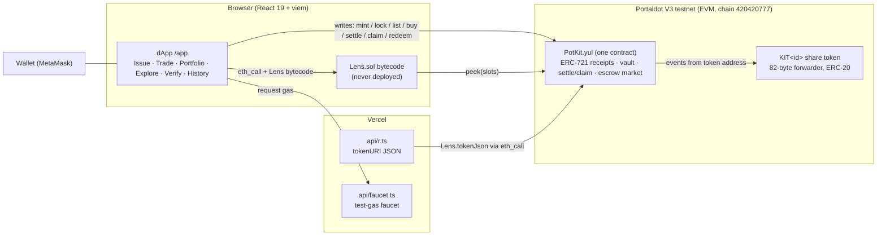
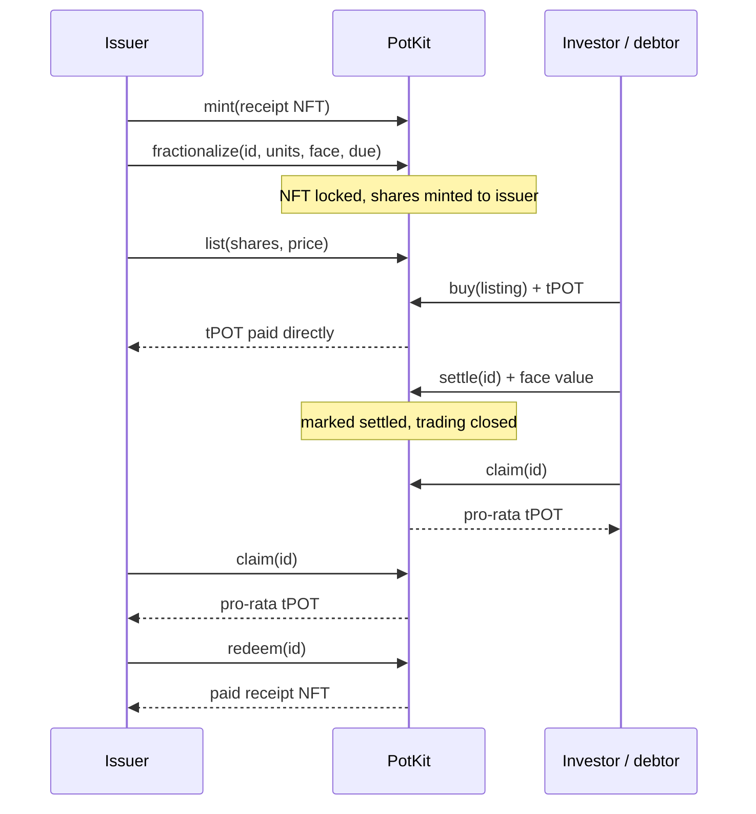

# PotKit — tokenised receipts on Portaldot V3

**Track:** Ecosystem DApps (RWA tokenisation) · Portaldot Hacker House 2026

PotKit turns a real-world receipt (an invoice, a content right, a piece of equipment) into an
**ERC-721**, locks it, and issues a fixed supply of **ERC-20 shares** against it.
The shares are *backed*: while they exist the NFT cannot move, and whoever gathers 100% of them
can take the NFT back. When the debtor **pays the invoice in native tPOT**, every holder burns their shares and
**claims a pro-rata payout**. A public **board** reads everything straight from the chain.

Since v31 everything lives in **one contract, `PotKit`** (hand-written Yul, 3.9 KB): the receipt NFT, the vault,
the settlement pool and the share market. Each share token is an 82-byte forwarder whose ERC-20 logic also runs in `PotKit`.

```
Issuer ── mint ──▶ PotKit (ERC-721 receipts, ERC-165, tokenURI)
Owner ── fractionalize(id, units, face, due) ──▶ PotKit: NFT locked, terms fixed, KIT<id> ERC-20 shares minted to owner
Holders ── transfer / list / buy shares (tPOT) ──▶ anyone      100% holder ── redeem ──▶ NFT returns, shares burned
Anyone (debtor) ── settle{value ≥ face} ──▶ PotKit (marked settled, trading closes)
Each holder ── claim ──▶ burns own shares, receives amount × shares / supplyAtSettlement
After every share is claimed ── depositor redeems ──▶ NFT returns as a "paid" receipt
```

## Architecture


**Lifecycle**


## Why it is more than a demo
| Concern | How PotKit handles it |
|---|---|
| Are shares really backed? | `PotKit` holds the NFT while shares exist; shares can only be burned by `PotKit` (redeem / claim) |
| Standards | ERC-721 + ERC-165 + metadata (`tokenURI` → `/api/r?id=N`, JSON built by `Lens` from on-chain data); shares are ERC-20 (transfer, approve, allowance, transferFrom, events) |
| Who can attest receipts? | Issuer + issuer-approved minters; anyone can hold, trade and fractionalize what they own |
| Can supply be inflated? | No. Supply is fixed at lock time; no mint function exists for shares |
| Nonexistent ids | `ownerOf` / `tokenURI` revert |
| Do shares have real value? | `settle` takes native tPOT ≥ face value into the pool; `claim` pays `amount × shares / supply` (cumulative rounding, the pool empties exactly) |
| Settlement griefing | Terms are fixed in the same transaction as the lock; anyone may pay, but only ≥ face value, and only once |
| Exits after pay | Settling twice reverts; redeem is blocked until every share is claimed, then only the depositor can take the paid receipt back |
| Reentrancy | Checks-effects-interactions everywhere: state is written before any tPOT is sent, and the payment is the last call |
| Spoofed tokens/events | Only `PotKit`-created share tokens are accepted (`token → receipt` mapping); share events are emitted by the token address itself |
| Secondary market | Escrowed fixed-price listings, partial buys, cost rounds up, exact `msg.value`, seller paid directly, closed after settlement |
| Invoice status | Pending / Due soon (≤ 3 days) / Overdue / Settled, derived by `Lens` from on-chain due date + settlement |
| Frontend state | Everything comes from the chain (`Lens` run inside `eth_call`): shareable "judge link", no database |
| Reproducible builds | `scripts/compile.mjs` with pinned `solc@0.8.28` (Yul + Solidity), optimizer runs = 1, EVM `paris` (no PUSH0), no metadata |

## Landing page
`/` is a monochrome HUD-style intro (v7): fixed header (centred logo, X / Discord / GitHub) and fixed footer (Docs / Portaldot /
Website + Whitepaper, Launch dApp + Read docs CTAs, live scroll coordinate, Hackathon). Pinned scroll stage: (1) hero over a rotating particle
globe with nebula + radar grid, (2) camera zooms in, receipt markers pop up over the globe + 4 feature points, (3) globe pans
away, 4 line-icon cards, (4) dark full-width horizontal bands that expand on hover or scroll, each with an animated glowing line-art object.
The dApp is a separate full page at **`/app`** (own sidebar layout). Old `#/app` links redirect to `/app` keeping the query string; judge links are `/app?kit=0x…` (old `?vault=` / `?receipt=` links still work). A faint, short-lived cursor smoke trail (canvas) appears only while the mouse or finger moves and fades out within ~0.6 s. Motion always runs (reduced-motion only slows it).
Social links were checked against the hrefs on https://portaldot.world/.

## Hosting on Vercel
`vercel.json` rewrites every path except `/api/*` to `index.html`, so `/app` works on refresh (static assets are served first).
Redeploy: `vercel --prod` from the project folder (keep the `.vercel/` folder that links it to the existing project, or run `vercel link` and pick `potkit`).

**Receipt metadata:** `tokenURI(id)` returns `https://potkit.pro/api/r?id=N`. `api/r.ts` (which also adds an `image`) answers it by running `Lens.tokenJson` in an
`eth_call` against the contract in `VITE_KIT` (override with `&kit=0x…`; RPC from `VITE_RPC_URL`). Set `VITE_KIT` on Vercel so the endpoint knows the deployment.

**Optional `app.` subdomain:** if the hostname starts with `app.`, the dApp renders at `/` and "Back to site" points to the bare domain.
1. Vercel → Project *potkit* → Settings → Domains → Add `app.yourdomain.com` (and `yourdomain.com` for the landing).
2. Add the DNS record Vercel shows (CNAME `app` → `cname.vercel-dns.com`).
3. Both domains use the same deployment; no code change needed. (`*.vercel.app` names can't take an `app.` prefix — use a custom domain.)

## Local UI testing with sample data
`VITE_RPC_URL` overrides the RPC (default: public Portaldot V3 testnet). For a filled-in UI without testnet gas:
```bash
npx ganache --chain.chainId 420420777 --wallet.deterministic   # terminal 1
npm run compile && node scripts/seed-local.mjs        # deploys PotKit + sample receipts/listings/settlement, prints the address
VITE_RPC_URL=http://localhost:8545 npm run dev        # open /app?kit=0x… (import a ganache key into MetaMask)
```

## Run guide (step by step)

### 1. Local dev
Requires Node.js 20+.
```bash
npm install
npm test        # compiles contracts + 28 tests (14 PotKit tests on a local ganache chain, faucet, network switch)
npm run dev     # open the URL Vite prints (http://localhost:8080 by default)
npm run build   # type-check + production build into dist/
```

### 2. Add Portaldot V3 Testnet to MetaMask
MetaMask → network selector → **Add network → Add a network manually**:

| Field | Value |
|---|---|
| Network name | Portaldot V3 Testnet |
| RPC URL | `https://test-evm-rpc-v3.portaldot.dev` |
| Chain ID | `420420777` |
| Currency symbol | `tPOTv3` (14 decimals) |

(Or just press **Switch to Portaldot V3** in the app — it adds the network for you.)

### 3. Map your account and fund gas
Portaldot gas is paid by the **mapped** Substrate account, not the 0x address directly.
1. Open the [node console](https://node-console.portaldot.dev/) → Developer → Runtime calls → `reviveApi` → `accountId`, enter your 0x address to get the mapped account.
2. Fund that mapped account with tPOTv3 (faucet / Discord, see the [testnet guide](https://github.com/ItsCogumellum/portaldot-v3-testnet-guide)).
3. A second wallet for the "buyer / debtor" role needs ~6 tPOT (buy + 1 tPOT face value + ~3.9 tPOT settle deposit + gas): send it from wallet A (a plain transfer to its 0x address credits its mapped account).

### 4. Deploy from the UI (one transaction, ≈327 tPOT)
1. **Issue → Deploy** (one transaction). You are now the receipt issuer. There is no token or market to deploy: payments are native tPOT.
2. **Copy judge link** — the URL carries the address (`/app?kit=0x…`). To bake it into a hosted build, put it in `.env`
   (`VITE_KIT`, plus `VITE_FROM_BLOCK` = deploy block, see `.env.example`) and rebuild. The old names `VITE_RECEIPT` / `VITE_VAULT` / `VITE_MARKET`
   are still read and may all point to the same address; `VITE_USD` is unused.
   Vite bakes these at build time — on Vercel set them as Environment Variables and redeploy after each change.
   When the baked `.env` deployment changes, browsers automatically drop their old saved addresses; **Profile → Reset saved deployment** does it manually.

### 5. Demo script (≈3 min, ≈47 tPOT of deposits)
1. Mint *"Invoice 042 — content delivery"* (kind Invoice).
2. **Lock, set terms & issue shares**: 100 shares, face value 1 tPOT, due date in ~2 days → badge **Due soon** (a past due date shows **Overdue**). One transaction.
3. **Trade → List** 90 shares at 0.009 tPOT (the freelancer sells at a 10% discount for cash now). No approval step.
4. Send ~6 tPOT to wallet B. Switch to wallet B and buy 90 shares (0.81 tPOT goes straight to the seller).
5. Wallet B (as debtor) → **Explore → Pay** on the receipt: 1 tPOT → badge **Settled**, trading closes.
6. Each holder opens **Portfolio** and presses **Claim**: B gets 0.9 tPOT (profit 0.09), A gets 0.1 tPOT.
7. Wallet A: **Portfolio → Redeem** takes the paid receipt NFT back (refunds the lock's storage deposit). Show **Explore** / **Verify**.

### Invoice status (`Lens.statuses()`)
`None` (not locked) · `Pending` · `Due soon` (≤ 3 days to due date) · `Overdue` (past due, unpaid) · `Settled`.
The due date is optional (0 = none). Late payment is still accepted.

### Market (inside `PotKit`)
Fixed-price listings priced in tPOT. Shares are **escrowed** in the contract on `list`, so a listing can never point at shares the
seller has moved; `buy(listing, amount)` takes partial or full amounts, cost rounds **up** in the seller's favour and must be sent
exactly as `msg.value` (that also replaces a slippage cap: the price can't change under you); payment goes to the seller directly;
`cancel` returns the rest. Listing needs a locked, unsettled receipt; buying/listing is blocked once the invoice is settled (cancel, then claim).

### Profile & Demo guide
- **Profile** (wallet menu → My Profile): address, wallet, balances, holdings, recent activity, the **mapped gas account** (with Copy), and **Reset saved deployment**.
- **Demo guide** (floating button): 7-step checklist — mint, lock + terms, list, buy, settle, claim, redeem — computed from contract state (listings, held shares), with the local action log as fallback, so it works even when the RPC limits `eth_getLogs`.

Deployed on Portaldot V3 Testnet (chain 420420777):
- PotKit: `0x3c26351ad8b9dc7bb4f837c5b921879c35e20fb7`
- Deploy tx: `0x5ce8a4a4661025a4cac0fe059dd3f10b111a05890c4530abb5d6490c9bf41614`
- Deploy block: `97421`
- Judge link: https://app.potkit.pro/?kit=0x3c26351ad8b9dc7bb4f837c5b921879c35e20fb7

### Full lifecycle executed on Portaldot V3 testnet
Run with two wallets (issuer/seller and investor/debtor). Hashes can be checked with `eth_getTransactionReceipt` on `https://test-evm-rpc-v3.portaldot.dev`.

| # | Step | Block | Tx hash |
|---|---|---:|---|
| 1 | Mint receipt #1 | 97600 | `0x734848b6b369f4b54fd204f0fe96253bab46bb6cd73ff495f5f36bba2bcd7bee` |
| 2 | Lock + set terms + issue 100 shares | 97632 | `0x6b36874b7e82cb29098017292314243aea17accc1825169b6ea81223637a846d` |
| 3 | List 90 shares @ 0.009 tPOT | 97654 | `0x36d70079020ad47a3b7350794c706bc68a87980cac1e08789a0516f4cc7ede4d` |
| 4 | Buy 90 shares (0.81 tPOT) | 97684 | `0xd9adf39c377817b8761e9e48814ba18c605dd464e9e3fd7515b9fbab8b930cb5` |
| 5 | Settle (debtor pays 1 tPOT) | 97706 | `0xa3c4e3920fc77a62d5c6c9902994285ff22345f92feb69e824d6583db81df25c` |
| 6 | Claim (investor, 0.9 tPOT) | 97713 | `0x41e96b79547671cf597ee0c3f7b27635fbfaf82c55b8b1231cecf47b640dd557` |
| 7 | Claim (issuer, 0.1 tPOT) | 97719 | `0x83cc9d7f3606d28e9cdd4c9dcd58525731987b79ffdf404a1952dd2bcf420e66` |
| 8 | Redeem paid receipt NFT | 97722 | `0x8e4f7704cce8d0224116c855f5789a5ef18260714a9520eddb00ed4e0cdf1b89` |

## On-chain cost (Portaldot storage deposit)
Portaldot V3 (pallet-revive) charges a **storage deposit**: about 0.079 tPOT for each byte of deployed code, ~13.3 tPOT per contract,
and about 3.9 tPOT for each new storage slot (refunded when the slot is cleared). Normal gas is tiny next to that.
Figures from `eth_estimateGas` on the V3 testnet (gas price ≈ 39,300 wei), measured with `node scripts/measure.mjs`:

| | v30 | v31 |
|---|---:|---:|
| Deploy (Receipt + Vault + TestUSD + Market → one PotKit) | 1,386 tPOT | **327 tPOT** |
| Mint receipt (30-char note / 140-char note) | 11.7 / 27.3 | 11.7 / ~27.3 |
| Lock + set terms (first lock) | 32.5 + 3.9 | **35.4** (one tx) |
| List shares | 19.5 | 11.7 |
| Buy (incl. faucet + approve in v30) | ~19.5 | 0 |
| Settle | 7.8 | 3.9 |
| Claim (each) | −3.9 | −3.9 (refund) |
| Redeem after full claim | — | −7.8 (refund) |
| **Full demo flow** (mint → lock+terms → list → buy → settle → 2 claims → redeem) | ~87 | **~47** |
| **Deploy + full demo** | ~1,473 | **~375** (+ ~1–2 tPOT gas) |

How: (1) **One contract** written in Yul instead of four Solidity contracts — code deposit is paid once. (2) **Native tPOT** for settlement
and trading: no TestUSD, no approvals, no faucet transaction. (3) Share tokens are **82-byte forwarders** (one code hash): every ERC-20 call is
forwarded to `PotKit`, which keeps balances and emits the events through the token. (4) **Everything read-only lives in `Lens.sol`**, which is
never deployed: viem runs its bytecode inside `eth_call` and it reads raw storage via `PotKit.peek(slots)`. (5) Packed storage, one generic
`Activity` event, one-letter revert codes (mapped back to readable messages in the UI via `REASON_CODES`), optimizer runs = 1, no metadata.
**Wallet fee display.** On Portaldot the gas estimate includes the storage deposit, so the gas *limit* is worth real money. For every write the
dApp sets the gas limit to the estimate + 20% and passes the chain's gas price as `maxFeePerGas` with a zero tip (otherwise a wallet adds its
default tip / base-fee multiplier and shows an absurd maximum). If estimate + 20% would exceed your balance, the buffer shrinks so the
maximum stays 1 tPOT under the balance (never below the raw estimate). For the deploy the wallet shows a maximum of ≈393 tPOT; ≈327 tPOT is actually charged.
Limits from packing: face value and listing price ≤ 2^96−1 wei, share units ≤ 2^40−1, due date ≤ 2^40−1 s.

## Layout
```
contracts/   PotKit.yul (the deployed contract)  IPotKit.sol (ABI)  Lens.sol (eth_call only)  test/TestReceiver.sol  v30/ (previous version, reference)
scripts/     compile.mjs  yulprep.mjs (revert codes)  seed-local.mjs  measure.mjs + measure/Harness.sol (live cost measurement)
api/         faucet.ts  r.ts (tokenURI JSON)
test/        potkit.test.mjs  faucet.test.mjs  netswitch.test.mjs
src/         main.tsx  Landing.tsx  landing.css  App.tsx  lib/chain.ts (viem)  styles.css
```
After editing a contract run `npm run compile` and commit `src/generated/`.

## Third-party software and assets
No third-party Solidity/Yul code is used in the contracts (`PotKit.yul`, `Lens.sol` are original). The web app and tooling use:

| Package | Version | License | Use |
|---|---|---|---|
| react, react-dom | 19.x | MIT | UI |
| viem | 2.57 | MIT | RPC, ABI encoding, wallet calls |
| @noble/hashes | 1.8 | MIT | blake2b for the mapped `5…` account |
| lenis | 1.3 | MIT | smooth scrolling on the landing page |
| vite, @vitejs/plugin-react | 7.x / 5.x | MIT | build tooling |
| typescript | 5.9 | Apache-2.0 | type checking |
| solc (solc-js) | 0.8.28 | MIT | compiling Yul / Solidity |
| ganache | 7.9 | MIT | local test chain |

Assets: wallet logos are bundled locally (see `src/assets/wallets/SOURCES.md`: web3icons MIT, simple-icons CC0; trademarks belong to their owners). Fonts Inter, JetBrains Mono and Space Grotesk are loaded from Google Fonts (SIL Open Font License). Landing and dApp visuals were created for this project.

## Known limitations
- **No debtor attestation yet.** Anyone can mint an invoice and the contract cannot verify that the debtor agreed to it; trust in the issuer is off-chain. Debtor signatures and issuer reputation are on the roadmap.
- **Shares left in an open listing at settlement** stay in escrow until the seller cancels; the depositor cannot redeem the NFT until every share is claimed, so sellers should cancel before or right after settlement.
- **Testnet only.** Payments use native tPOT; there is no stablecoin option or KYC for mainnet yet.
- **Contract is immutable** and its `tokenURI` points at `https://potkit.pro/api/r`; the JSON is built off-chain from chain state.

## License
MIT, see [LICENSE](./LICENSE).

## Beyond the hackathon (roadmap)
- Redeem-by-vote / partial buyout so fragmented holders can still exit
- ~~Revenue distribution: pay an invoice once, split pro-rata to share holders~~ ✅ shipped (`settle` / `claim`)
- ~~Secondary market for share tokens~~ ✅ fixed-price escrow market shipped; next: AMM pool / auctions
- ~~Invoice status~~ ✅ due date + Pending / Due soon / Overdue / Settled; next: partial payments, debtor attestation
- Indexer + explorer links once a Portaldot V3 explorer is available

## Gas faucet

New users can't send a transaction without tPOTv3, so PotKit ships a small **"Request test gas"** faucet:
a Vercel Function at `api/faucet.ts` (Node runtime, viem) plus a button in the gas tip, the Profile page
and the "not enough gas" banner that appears when a write fails for insufficient funds.

- `GET /api/faucet?address=0x…` → `{ enabled, address, balance, amount, recipient: { balance, eligible } }`
- `POST /api/faucet` `{ "address": "0x…", "chainId": 420420777 }` → `{ ok, hash }` or `{ ok:false, error, message }`
  with `error` ∈ `bad_address`, `wrong_chain`, `already_funded`, `rate_limited`, `faucet_empty`, `faucet_disabled`, `rpc_unavailable`, `send_failed`.

Amounts are in the **18-decimal EVM view** (the Ethereum RPC scales Portaldot's 14-decimal native unit to 18;
the same as wallets). A native transfer to a 0x address credits that address's mapped `5…` gas account.

### Setup (Vercel)
1. Create a **new, dedicated** EVM wallet just for the faucet (never your main or deployer wallet).
2. Find its mapped gas account (connect it in PotKit → Profile, or the node console) and fund that `5…` account with a **small** amount of tPOTv3.
3. Vercel → Project → Settings → Environment Variables (**Production**): set `FAUCET_PRIVATE_KEY` (and optionally `FAUCET_AMOUNT`, default `0.5`; `FAUCET_THRESHOLD`; `FAUCET_MAX_PER_HOUR`, default `30`; `FAUCET_RPC_URL`). **Do not** prefix them with `VITE_` — that would ship the key to every browser.
4. Optional but recommended: add Vercel KV / Upstash Redis (Marketplace) so `KV_REST_API_URL` + `KV_REST_API_TOKEN` (or `UPSTASH_REDIS_REST_URL` + `UPSTASH_REDIS_REST_TOKEN`) are set — rate limits then hold across instances.
5. Redeploy. Check `https://<site>/api/faucet` returns `"enabled": true` and the faucet balance.

`vercel.json` rewrites everything **except** `/api/*` to `index.html`.

### Limits and abuse protection (honest version)
- 1 request per address per 24 h, 1 per client IP per 24 h, a global hourly cap, and no send if the recipient already holds ≥ the threshold.
- Without KV, limits live in memory of a warm serverless instance: they reset on cold start and aren't shared between instances. Treat that as best-effort only; use KV for real limits.
- IPs come from Vercel's `x-real-ip` / `x-forwarded-for`; VPNs and new addresses can still get around limits. The real protection is a **small faucet balance** — refill it by hand.
- No captcha. Testnet only.

### Local development
- `npm run dev` serves `/api/faucet` through a small Vite dev middleware. Put `FAUCET_PRIVATE_KEY=…` in `.env.local` (git-ignored, server-only) to enable it; without it the button shows the manual-funding fallback (mapped `5…` address + Copy).
- Or run `vercel dev` to emulate the platform exactly.
- `vite preview` / static hosts have no API → the UI falls back automatically.
