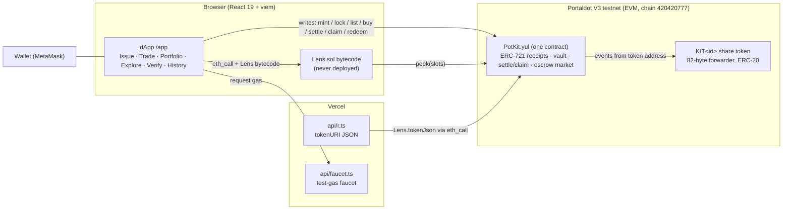
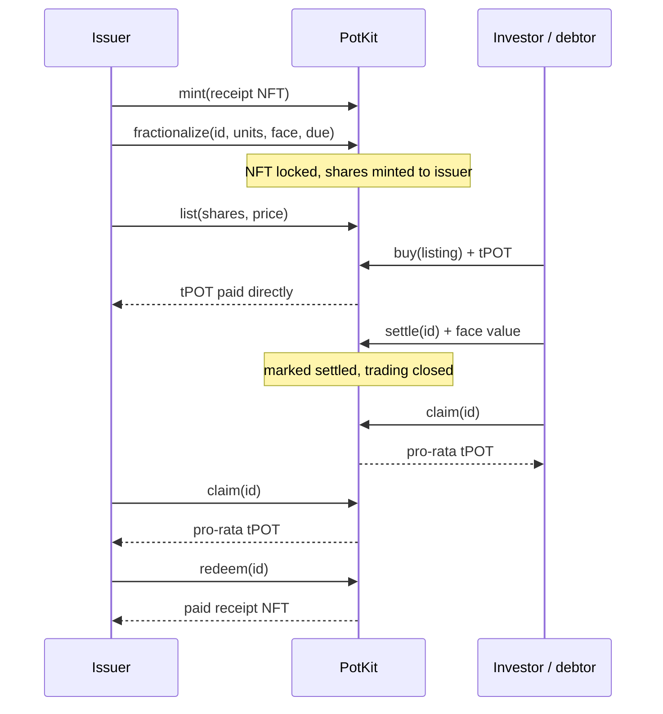

# PotKit - Invoices that pay you now

**Track:** Ecosystem DApps (RWA tokenisation) · Portaldot Hacker House 2026
**One-liner:** Tokenise an unpaid invoice into backed, tradeable shares on Portaldot V3 - and pay every holder pro-rata, on-chain, when the debtor settles.

## Problem
Freelancers and small businesses often have to wait to get paid after they deliver the work. Factoring is opaque, manual and closed to small invoices.
Investors who would happily fund a receivable have no simple, verifiable way to buy a slice of one and get paid out automatically.

## Solution
PotKit puts the whole receivable lifecycle on-chain, in **one contract**:
1. **Mint** the invoice as an ERC-721 receipt (note, kind, issuer; `tokenURI`).
2. **Lock, set terms & fractionalize** in one transaction: the receipt stays in PotKit, its face value (in tPOT) and due date are fixed, and a fixed supply of ERC-20 shares is minted to the owner.
3. **Trade**: the owner lists shares at a discount on a fixed-price escrow market; buyers pay native tPOT for any amount.
4. **Settle & claim**: the debtor pays the face value in native tPOT; each holder burns their shares and claims `amount × shares / supply`. Once every share is claimed the depositor can redeem the paid receipt.
Invoice status — Pending, Due soon (≤ 3 days), Overdue, Settled — is derived from the on-chain due date and settlement.

## How it works (contracts)
| Contract | Role |
|---|---|
| `PotKit.yul` | The only deployed contract (3.9 KB, hand-written Yul). ERC-721 + ERC-165 + metadata receipts; issuer and approved minters; `fractionalize(id, units, face, due)`; `settle` (payable, ≥ face, anyone); `claim`; `redeem`; escrow market `list` / `buy` (payable, exact cost) / `cancel`; ERC-20 logic of every share token; `peek(slots)` for raw reads |
| Share tokens | One 82-byte forwarder per receipt (same code hash for all, so code is paid once): forwards every ERC-20 call to PotKit and emits `Transfer` / `Approval` from its own address. Re-locking a redeemed receipt reuses its token |
| `IPotKit.sol` | ABI of PotKit and of the share token (`IFraction`) |
| `Lens.sol` | All view logic for the UI (`rows`, `balances`, `settlements`, `claimables`, `statuses`, `listings`, `meta`, `tokenJson`), **never deployed**: viem runs it inside `eth_call` and it reads storage through `peek` |
| `api/r.ts` | Serves `tokenURI` JSON (`/api/r?id=N`) by running `Lens.tokenJson` in an `eth_call` |

**Safety choices:** no external libraries; checks-effects-interactions everywhere (all state written before tPOT leaves, the payment is the last call);
payout rounding is cumulative so the pool always empties exactly; terms are fixed at lock time, so anyone may settle but only with ≥ face value, once;
redeem needs 100% of the outstanding shares and, after settlement, waits until every share is claimed; only PotKit-created share tokens are
accepted; listing needs a locked, unsettled receipt; buy needs the exact cost (rounded up for the seller) as `msg.value`.

## Architecture

**Lifecycle**

## Portaldot V3 features used
- **EVM compatibility** (pallet-revive): Yul + Solidity 0.8.28 compiled for EVM `paris` (no PUSH0) for maximum compatibility.
- **Native tPOT** settlement and trading (`msg.value`): no test stablecoin, no approvals.
- **Built for revive's storage deposit**: Portaldot charges a deposit for every byte of code (≈0.079 tPOT per byte, ~13 tPOT per contract) and every new storage item (≈3.9 tPOT, refunded when cleared). Each participant gets at most 500 tPOT, so PotKit is sized to fit: one 3.9 KB contract, 82-byte share forwarders, packed storage, one generic event, one-letter revert codes, and all reads in the never-deployed `Lens`.

### On-chain cost (measured with `eth_estimateGas` on the V3 testnet, `scripts/measure.mjs`)
| | v30 (4 contracts) | v31 (one PotKit) |
|---|---:|---:|
| Deploy | 1,386 tPOT | **327 tPOT** |
| Mint receipt (30-char note) | 11.7 | 11.7 |
| Lock + set terms | 36.4 (2 tx) | 35.4 (1 tx) |
| List | 19.5 | 11.7 |
| Buy (incl. faucet + approve in v30) | ~19.5 | 0 |
| Settle | 7.8 | 3.9 |
| 2 claims + redeem | −7.8 | −15.6 (refunds) |
| **Full demo flow** | ~87 | **~47** |
| **Deploy + full demo** | ~1,473 | **~375** (+ ~1–2 gas) of a 450 tPOT budget |
- **Portaldot V3 Testnet**, chain id **420420777**, RPC `https://test-evm-rpc-v3.portaldot.dev`, gas token `tPOTv3`.
- **Mapped accounts**: the UI explains and links the mapping flow (node console → `reviveApi.accountId`) so gas is paid by the mapped account.
- MetaMask / injected-wallet UX with one-click "Switch to Portaldot V3" (`wallet_addEthereumChain`).

## dApp at a glance
Dashboard (market figures and an 8-step lifecycle tracker, all read from the chain) · Issue (one-click deploy + guided 3-step wizard with live receipt preview) · Trade (listing board, quick buy, sell panel, cash-now planner) · Portfolio (shares held, claims with *Claim all*, open listings, receipts issued; CSV and calendar export) · Explore (network explorer, judge link, "Load older") · Verify (shareable proof) · History (on-chain timeline, CSV export) · Profile (wallet identity, on-time payment record, mapped gas account) · Pay page (`?tab=pay&id=N`, debtor view with an optional off-chain EIP-712 acknowledgement; the contract does not use it).
Read-only mode: Explore and Verify work without a wallet through a direct RPC client (with retries and an optional fallback RPC).

## Tech stack
Yul + Solidity 0.8.28 (solc-js, pinned) · custom compile script (no Hardhat) · node:test + ganache · React 19 + TypeScript + Vite 7 ·
viem 2 · lenis (smooth scroll on the docs pages) · canvas 2D intro animation. No database: every screen reads the chain directly (the only server code is the optional gas faucet and the `tokenURI` JSON endpoint).

## What's tested (`npm test`)
- ERC-721 compliance (ERC-165, approve, operators, transferFrom, safeTransferFrom with receiver contracts and rejection), mint permissions, unknown ids revert
- Notes of every length 1–140 stored losslessly; metadata JSON escapes quotes, backslashes and control characters
- Lock: owner-only, terms set in the same call, whole supply to the owner; share tokens are identical 82-byte forwarders and their events cannot be spoofed
- ERC-20: transfer, approve, allowance, transferFrom (infinite allowance), contract callers
- Redeem needs every share; re-lock reuses the token and resets allowances
- Settlement in native tPOT by anyone; pro-rata claims sum exactly to the pool; overpayment, contract holders, settle on an unlocked receipt; redeem after full claim
- Status lifecycle Free → Pending → Due soon → Overdue → Settled (time-warped)
- Market: escrow, partial and full buys with exact tPOT, round-up cost, seller paid, cancel; no listing on unlocked receipts; trading blocked after settlement while cancel + claim still work
- Lens windows (`rows`, `balances`, `claimables`, `listings`) consistent
- Gas faucet API and wallet network switching
- Settle-amount checks (underpay, exact, overpay needs confirmation), Trade input precision (at most 18 decimals), receipt-history rules, and the dashboard figures (issuer record, due buckets, per-day series, sale plan, CSV and calendar export)

## Deployed contracts (Portaldot V3 testnet)
- PotKit (receipts, vault, settlement, market): `0x3c26351ad8b9dc7bb4f837c5b921879c35e20fb7`
- Deploy tx hash: `0x5ce8a4a4661025a4cac0fe059dd3f10b111a05890c4530abb5d6490c9bf41614`
- Deploy block: `97421` (block time 2026-10-19 03:15:12 UTC; status success, deployed code 3,910 bytes)

### Full lifecycle executed on Portaldot V3 testnet
Run with two wallets (issuer/seller and investor/debtor). Each hash was re-checked with `eth_getTransactionReceipt` on `https://test-evm-rpc-v3.portaldot.dev` (status success, sent to the kit); times are block timestamps in UTC. The node console opens block numbers, not EVM transaction hashes, so each block links to its console page and each hash to the community explorer Pindex, which resolves EVM hashes on the V3 testnet (all nine checked on 2026-10-30).

| # | Step | Block | Time (UTC) | Transaction hash |
|---|---|---:|---|---|
| 1 | Deploy kit | [97421](https://node-console.portaldot.dev/?rpc=wss%3A%2F%2Ftest-node-v3.portaldot.dev#/explorer/query/97421) | 2026-10-19 03:15:12 | [`0x5ce8a4a4661025a4cac0fe059dd3f10b111a05890c4530abb5d6490c9bf41614`](https://pindex.onrender.com/app/?q=0x5ce8a4a4661025a4cac0fe059dd3f10b111a05890c4530abb5d6490c9bf41614) |
| 2 | Mint receipt #1 | [97600](https://node-console.portaldot.dev/?rpc=wss%3A%2F%2Ftest-node-v3.portaldot.dev#/explorer/query/97600) | 2026-10-19 03:33:06 | [`0x734848b6b369f4b54fd204f0fe96253bab46bb6cd73ff495f5f36bba2bcd7bee`](https://pindex.onrender.com/app/?q=0x734848b6b369f4b54fd204f0fe96253bab46bb6cd73ff495f5f36bba2bcd7bee) |
| 3 | Lock + terms + issue 100 shares | [97632](https://node-console.portaldot.dev/?rpc=wss%3A%2F%2Ftest-node-v3.portaldot.dev#/explorer/query/97632) | 2026-10-19 03:36:18 | [`0x6b36874b7e82cb29098017292314243aea17accc1825169b6ea81223637a846d`](https://pindex.onrender.com/app/?q=0x6b36874b7e82cb29098017292314243aea17accc1825169b6ea81223637a846d) |
| 4 | List 90 shares @ 0.009 tPOT | [97654](https://node-console.portaldot.dev/?rpc=wss%3A%2F%2Ftest-node-v3.portaldot.dev#/explorer/query/97654) | 2026-10-19 03:38:30 | [`0x36d70079020ad47a3b7350794c706bc68a87980cac1e08789a0516f4cc7ede4d`](https://pindex.onrender.com/app/?q=0x36d70079020ad47a3b7350794c706bc68a87980cac1e08789a0516f4cc7ede4d) |
| 5 | Buy 90 shares (0.81 tPOT) | [97684](https://node-console.portaldot.dev/?rpc=wss%3A%2F%2Ftest-node-v3.portaldot.dev#/explorer/query/97684) | 2026-10-19 03:41:30 | [`0xd9adf39c377817b8761e9e48814ba18c605dd464e9e3fd7515b9fbab8b930cb5`](https://pindex.onrender.com/app/?q=0xd9adf39c377817b8761e9e48814ba18c605dd464e9e3fd7515b9fbab8b930cb5) |
| 6 | Settle (debtor pays 1 tPOT) | [97706](https://node-console.portaldot.dev/?rpc=wss%3A%2F%2Ftest-node-v3.portaldot.dev#/explorer/query/97706) | 2026-10-19 03:43:42 | [`0xa3c4e3920fc77a62d5c6c9902994285ff22345f92feb69e824d6583db81df25c`](https://pindex.onrender.com/app/?q=0xa3c4e3920fc77a62d5c6c9902994285ff22345f92feb69e824d6583db81df25c) |
| 7 | Claim (investor, 0.9 tPOT) | [97713](https://node-console.portaldot.dev/?rpc=wss%3A%2F%2Ftest-node-v3.portaldot.dev#/explorer/query/97713) | 2026-10-19 03:44:24 | [`0x41e96b79547671cf597ee0c3f7b27635fbfaf82c55b8b1231cecf47b640dd557`](https://pindex.onrender.com/app/?q=0x41e96b79547671cf597ee0c3f7b27635fbfaf82c55b8b1231cecf47b640dd557) |
| 8 | Claim (issuer, 0.1 tPOT) | [97719](https://node-console.portaldot.dev/?rpc=wss%3A%2F%2Ftest-node-v3.portaldot.dev#/explorer/query/97719) | 2026-10-19 03:45:00 | [`0x83cc9d7f3606d28e9cdd4c9dcd58525731987b79ffdf404a1952dd2bcf420e66`](https://pindex.onrender.com/app/?q=0x83cc9d7f3606d28e9cdd4c9dcd58525731987b79ffdf404a1952dd2bcf420e66) |
| 9 | Redeem paid receipt NFT | [97722](https://node-console.portaldot.dev/?rpc=wss%3A%2F%2Ftest-node-v3.portaldot.dev#/explorer/query/97722) | 2026-10-19 03:45:18 | [`0x8e4f7704cce8d0224116c855f5789a5ef18260714a9520eddb00ed4e0cdf1b89`](https://pindex.onrender.com/app/?q=0x8e4f7704cce8d0224116c855f5789a5ef18260714a9520eddb00ed4e0cdf1b89) |
- Share tokens: created by PotKit on each lock (`Lens.rows` lists them)

## Known limitations
- **No debtor attestation yet.** Anyone can mint an invoice and the contract cannot verify that the debtor agreed to it; trust in the issuer is off-chain. Debtor signatures and issuer reputation are on the roadmap.
- **Shares left in an open listing at settlement** stay in escrow until the seller cancels; the depositor cannot redeem the NFT until every share is claimed, so sellers should cancel before or right after settlement.
- **Testnet only.** Payments use native tPOT; there is no stablecoin option or KYC for mainnet yet.
- **Minting is permissioned.** Only the issuer and approved minters can mint (`not minter` otherwise); anyone can still hold, trade, settle and claim. Judges can run the local demo (README → Judge quick start) or be approved with `scripts/set-minter.mjs`.
- **The PotKit faucet is closed.** Hackathon test tokens are handed out by the Portaldot team.
- **Overdue is an app rule.** The contract accepts a purchase until the invoice is settled; the app hides Buy on overdue listings.
- **Contract is immutable** and its `tokenURI` points at `https://potkit.pro/api/r`; the JSON is built off-chain from chain state.

## Business potential (a plan, not shipped)
This section is the builder's plan. It states no market size, customers, partners, revenue or usage, because there are none yet: PotKit is a testnet demo built by one person.
- **First users:** freelancers and small businesses with unpaid invoices, as issuers. Minting is permissioned today (the issuer and approved minters), so they are onboarded one by one with `scripts/set-minter.mjs` (README → step 6). Anyone can buy, trade, settle and claim without approval.
- **Earning:** none today. The contract takes no fee and PotKit is open source (MIT). The near-term plan is ecosystem support through Portaldot's post-hackathon programme. A fee or paid software would be a later decision, and a fee needs a contract change and a new deployment (about 327 tPOT).
- **First channel:** the Portaldot community (Discord, X, Hacker House mentors and testers). A tester sends an address, the issuer approves it, and the resulting testnet transactions are checkable evidence.
- **Why now:** Portaldot V3's new EVM path (pallet-revive) and a design built around its storage deposit: deploy about 327 tPOT against 1,386 in the first design, full demo about 47 against 87 (testnet estimates from `scripts/measure.mjs`, not mainnet cost).
- **Limits that stay true:** issuer-provided details are not verified by PotKit, and payment is not guaranteed.

## Roadmap
- Partial payments and instalments; debtor attestation / signature on terms
- Credit and reputation signals per issuer and debtor
- AMM pool or auctions for Fraction shares; price discovery by time-to-due
- Stablecoin settlement option and KYC'd issuer registry for mainnet
- Indexer + explorer links when a Portaldot V3 explorer is available

## Third-party software and assets (disclosure)
No third-party Solidity/Yul code is used in the contracts (`PotKit.yul`, `Lens.sol` are original). The web app and tooling use:

| Package | Version | License | Use |
|---|---|---|---|
| react, react-dom | 19.x | MIT | UI |
| viem | 2.57 | MIT | RPC, ABI encoding, wallet calls |
| @noble/hashes | 1.8 | MIT | blake2b for the mapped `5…` account |
| lenis | 1.3 | MIT | smooth scrolling on the docs pages |
| vite, @vitejs/plugin-react | 7.x / 5.x | MIT | build tooling |
| typescript | 5.9 | Apache-2.0 | type checking |
| solc (solc-js) | 0.8.28 | MIT | compiling Yul / Solidity |
| ganache | 7.9 | MIT | local test chain |

Assets: wallet logos are bundled locally (see `src/assets/wallets/SOURCES.md`: web3icons MIT, simple-icons CC0; trademarks belong to their owners). Fonts Hanken Grotesk, Newsreader and IBM Plex Mono are loaded from Google Fonts (SIL Open Font License). Landing and dApp visuals were created for this project; layout ideas came from public design references, and no code, images, logos or text were copied.

## Links
- GitHub: https://github.com/itsjusttu/potkit-portaldot
- Website: https://potkit.pro
- Live dApp: https://app.potkit.pro
- Judge link (opens the exact deployed contracts): https://app.potkit.pro/?kit=0x3c26351ad8b9dc7bb4f837c5b921879c35e20fb7
- Video: https://youtu.be/Cr7XRDwAU6g
- License: MIT (see `LICENSE` in the repository)
